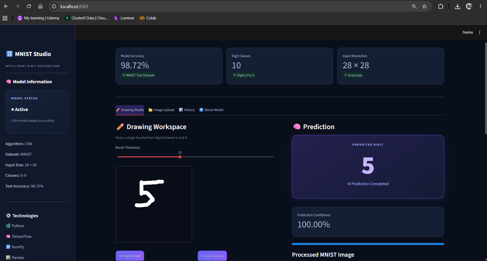
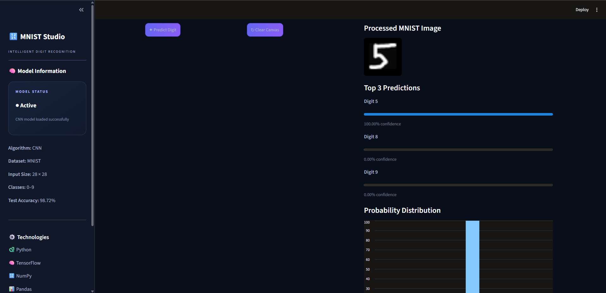

## MNIST Studio – Handwritten Digit Recognition
--------------------------------------------------------
## About the Project
-----------------
MNIST Studio is a handwritten digit recognition application built using Deep Learning and Convolutional Neural Networks (CNN). It allows users to draw or upload handwritten digits and predicts the corresponding number from 0 to 9.

## Model Performance
--------------------
Test Accuracy: 98.72%

Model: CNN

Dataset: MNIST

## Technologies Used
----------------
Python
TensorFlow / Keras
Streamlit
NumPy
Pillow
Matplotlib

## Features
----------
Draw handwritten digits on a canvas
Upload digit images
Predict digits from 0 to 9
Display prediction confidence
View top predictions

## Screenshots
-----------------------
### Home Page
-------

### Prediction
------

## Demo Video
-------
[Watch MNIST Studio Demo](demo/mnist-demo.mp4)

## Installation
------------
git clone https://github.com/aldrinjaison9495-cloud/MNIST-Studio.git cd MNIST-Studio pip install -r requirements.txt 

Run the Application
----------------------
streamlit run app.py 

Project Structure
------------------
MNIST-Studio/ │ ├── app.py ├── cnn_model.keras ├── requirements.txt ├── README.md └── .gitignore 

## Author
---------------
Aldrin Jaison

